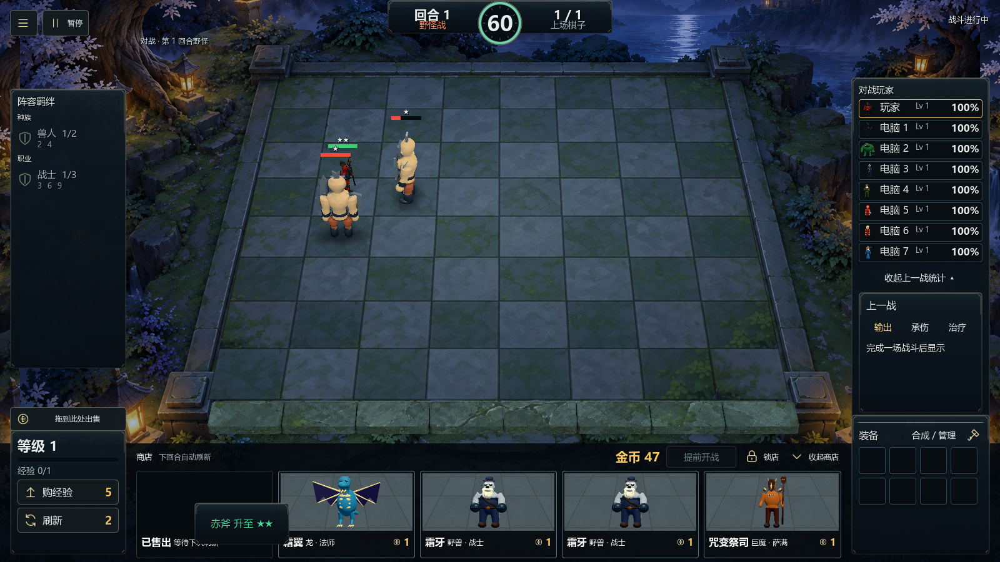

  
  

# 自走棋demo · Auto Chess Demo

**Recruit units. Build synergies. Position your team and upgrade your stars.**

**Portable edition · Download, extract, and play · No login required · Offline single-player · Dota Auto Chess–style gameplay**

A 3D single-player auto battler made with Godot. Face seven AI opponents and build your team from 71 units. Combine race and class synergies, equip your units, and adjust their positions to take on each battle.

[**Download for Windows**](https://github.com/lyoko-233/autochess-demo/releases/latest) · [Report an issue](https://github.com/lyoko-233/autochess-demo/issues)

Updated: 2026-11-07. Game version: V8. README version: V3. Windows x64 portable ZIP: approximately 361 MB. Godot is not required to play.

## Download and play

Visit [Releases](https://github.com/lyoko-233/autochess-demo/releases/latest), download the Windows portable ZIP, extract all files, and double-click `autochess.exe`. Keep the EXE and `autochess.pck` in the same folder. You do not need to install Godot.

## Development

Open the root `project.godot` file with Godot 4.7.2 and run the main scene. The project includes the game models, shared compressed textures, model screenshots, UI, audio, and runtime data. Editor caches, previous versions, and local test logs are excluded.

To export a Windows build, install the matching official Godot export templates. Use the `Windows Portable V8` export preset and set the output path to your preferred folder.

## Controls and features

Buy units and drag them onto the board. Drag them back to the shop area to sell them. Use the button to the right of your gold balance to start combat early. The main menu includes New Game, Continue, sound settings, and a searchable unit guide.

Victory or defeat audio plays when the battle on your board ends. A waiting message appears if other boards are still fighting. Shop portraits show the actual one-star models against a subtle stone-board background.

See the `licenses` folder for third-party software notices and asset sources.
