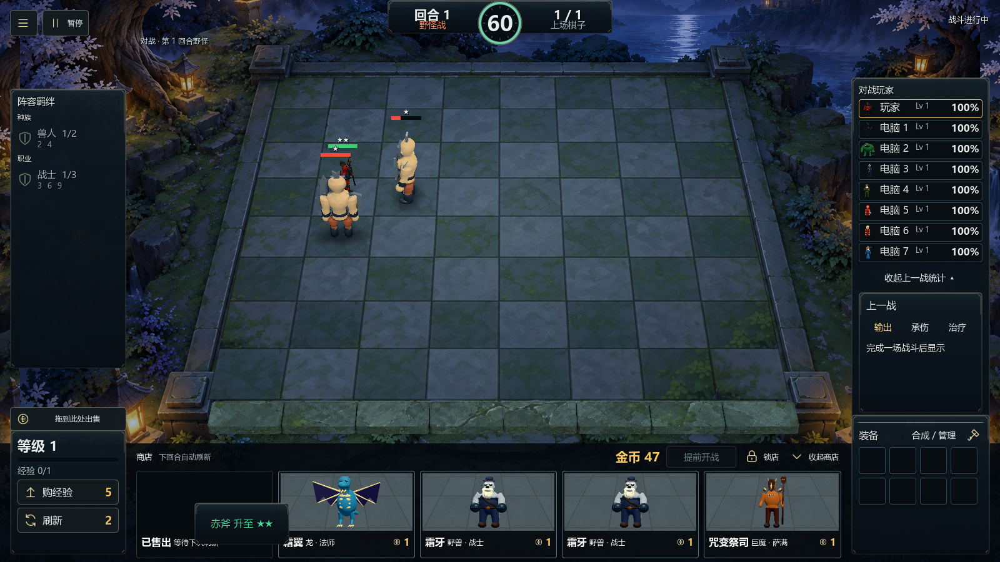

  
  

# 自走棋demo

**招募棋子，组合羁绊，布阵升星。**

**轻便版 · 下载解压即玩 · 无需登录 · 单机离线 · 类 Dota 自走棋玩法**

一款使用 Godot 制作的 3D 单机自走棋游戏。与 7 名电脑对手展开对局，从 71 名棋子中组建阵容，通过种族与职业羁绊、装备搭配和站位安排应对战斗。

[**下载 Windows 测试版**](https://github.com/lyoko-233/autochess-demo/releases/latest) · [反馈问题](https://github.com/lyoko-233/autochess-demo/issues)

更新时间：2026-11-07。游戏版本：V8。介绍页版本：V3。Windows x64 便携 ZIP 约 361 MB，无需安装 Godot。

## 下载游玩

打开[本仓库的 Releases](https://github.com/lyoko-233/autochess-demo/releases/latest)，下载 Windows 便携 ZIP，完整解压后双击 `autochess.exe`。无需安装 Godot；EXE 与 `autochess.pck` 必须保持同目录。

## 工程开发

使用 Godot 4.7.2 导入根目录的 `project.godot`，运行主场景。项目包含实际模型、共用压缩贴图、模型截图、界面、音效和运行数据，不含编辑器缓存、历史版本与本地测试日志。

导出 Windows 包前，在 Godot 中安装匹配版本的官方导出模板。使用 `Windows Portable V8` 导出预设，可将输出路径改为自己的目录。

## 操作

购买棋子后拖上棋盘，拖回商店区域可出售。金币右侧可提前开战。主菜单提供新游戏、继续游戏、声音设置和棋子介绍；图鉴支持搜索。

当前战场结束时播放胜负音效，其他战场未结束时显示等待提示。商店图片为实际一星模型截图，背景采用低对比度石质棋盘。

第三方软件与素材来源见 `licenses` 目录。
